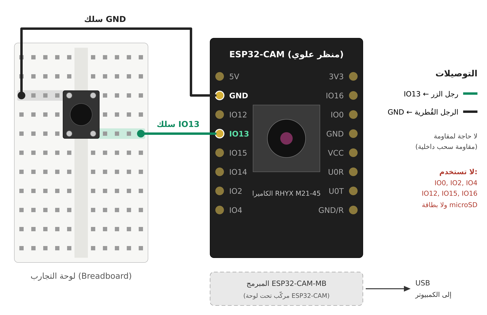
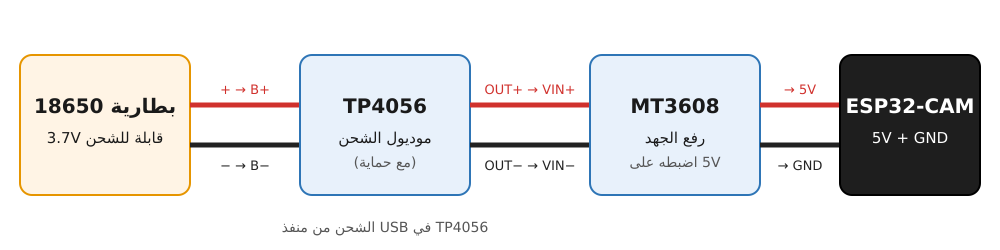
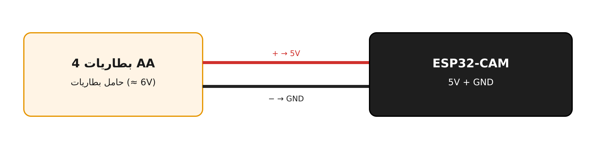

# ESP32-CAM Button Camera → Telegram

Press a physical pushbutton, and the ESP32-CAM takes a photo and sends it straight to your Telegram chat.
Built for ESP32-CAM boards that ship with the **RHYX M21-45** camera (GC2145-type sensor, no hardware JPEG).

> 🇸🇦 **دليل كامل بالعربي:** [`docs/ESP32-CAM_Telegram_Guide_AR.docx`](docs/ESP32-CAM_Telegram_Guide_AR.docx)

## Features

- One button press → one photo in Telegram (debounced, no duplicates)
- RGB565 frames converted to JPEG on the board (`frame2jpg`), since the RHYX M21-45 has no JPEG output
- Live camera web page still works (open the board's IP in a browser)
- Auto-reconnects if Wi-Fi drops
- No resistor needed: uses the ESP32's internal pull-up

## Credits

This project builds on **[YigitMusstafa/rhyx-m21-45-esp32-cam-web-server-code](https://github.com/YigitMusstafa/rhyx-m21-45-esp32-cam-web-server-code)**, which provides the working RHYX M21-45 pin map, camera settings and web server files. That work is itself based on Espressif's `CameraWebServer` example (Apache License 2.0).
Thank you to the original author. Without that repo this module would have been much harder to get running.

## Hardware

| Part | Notes |
|---|---|
| ESP32-CAM (AI Thinker) | With RHYX M21-45 camera |
| ESP32-CAM-MB programmer | USB power and upload |
| Tactile pushbutton + mini breadboard | The trigger |
| 2 jumper wires | Soldered to the IO13 and GND pins |

## Wiring



| ESP32-CAM pin | Connects to |
|---|---|
| **IO13** | Pushbutton leg |
| **GND** | Opposite (diagonal) pushbutton leg |

- Place the button **across the middle gap** of the breadboard.
- Do not use IO0, IO2, IO4, IO12, IO15 or IO16 (camera, flash LED, PSRAM, boot pins).
- Do not insert a microSD card (IO13 is shared with the SD slot).

## Setup

### 1. Arduino IDE

1. Install **Arduino IDE 2**.
2. In **File → Preferences → Additional boards manager URLs**, add:
   ```
   https://espressif.github.io/arduino-esp32/package_esp32_index.json
   ```
3. Install **esp32 by Espressif Systems** from the Boards Manager.
4. Select board **AI Thinker ESP32-CAM** and your COM port. Install the CH340 driver if no port appears.

### 2. Open the sketch

Open `esp32cam_telegram/esp32cam_telegram.ino` in Arduino IDE. The other files open as tabs:

```
esp32cam_telegram/
├── esp32cam_telegram.ino   ← main program (button + Telegram), edit settings here
├── app_httpd.cpp           ← live camera web server
├── camera_index.h          ← web page
├── camera_pins.h           ← pin map, includes CAMERA_MODEL_RHYX_M21
├── board_config.h
└── partitions.csv          ← used automatically by Arduino
```

The camera support files come from [YigitMusstafa/rhyx-m21-45-esp32-cam-web-server-code](https://github.com/YigitMusstafa/rhyx-m21-45-esp32-cam-web-server-code). They are Espressif `CameraWebServer` example files (Apache License 2.0) and are included unchanged with their original notices.

### 3. Create a Telegram bot

1. Message **@BotFather** → `/newbot` → copy the **bot token**.
2. Message **@userinfobot** to get your **chat ID**.
3. Open your new bot and press **Start** (required before it can message you).

### 4. Edit the settings

At the top of `esp32cam_telegram.ino`:

```cpp
const char* ssid     = "YOUR_WIFI_NAME";
const char* password = "YOUR_WIFI_PASSWORD";

const String BOT_TOKEN = "YOUR_BOT_TOKEN";
const String CHAT_ID   = "YOUR_CHAT_ID";
```

The ESP32 only connects to **2.4 GHz** Wi-Fi.

### 5. Upload and test

1. Click **Upload**. If it fails to connect, hold **IO0** on the MB board, tap **RST**, release IO0, and try again.
2. Open the Serial Monitor at **115200 baud** and press **RST**.
3. Press the button. You should see:
   ```
   Button pressed -> capturing...
   JPEG ready: ... bytes
   Photo sent to Telegram!
   ```

## Camera settings (from upstream, tuned for RHYX M21-45)

| Setting | Value |
|---|---|
| Pixel format | `PIXFORMAT_RGB565` (sensor has no JPEG) |
| Frame size | `FRAMESIZE_QVGA` (320×240) |
| XCLK | 10 MHz (prevents freezing) |
| Frame buffers | 2, in PSRAM, `CAMERA_GRAB_LATEST` |

## Battery power (optional)

| Option | Diagram |
|---|---|
| **Power bank** into the MB's Micro-USB. No changes needed. |  |
| **18650 + TP4056 + MT3608** (set the MT3608 to 5 V **before** connecting) → 5V / GND pins |  |
| **4 × AA** (~6 V) → 5V / GND pins |  |

⚠️ Never connect a 3.7 V Li-ion cell directly to the **3V3** pin (up to 4.2 V when charged), or to **5V** without a boost converter.

## Troubleshooting

| Problem | Fix |
|---|---|
| Stuck printing dots, no `WiFi connected` | Check SSID/password; make sure the network is 2.4 GHz |
| `Camera init failed` | Reseat the camera ribbon; power-cycle the board |
| `Connection to Telegram failed` | The network has no internet access |
| `Unauthorized` in the response | Wrong bot token |
| `chat not found` in the response | Wrong chat ID, or you didn't press Start in the bot |
| Button does nothing | Wires must be in the rows of **diagonal** button legs |
| Sending fails while the live page is open | Close the browser stream and try again |

## Security

Never commit your real Wi-Fi password or bot token. If a token leaks, revoke it with `/revoke` in @BotFather.

## License

- `esp32cam_telegram.ino`, the docs and the diagrams: [MIT License](LICENSE), © 2026 Farah AlHayek.
- `app_httpd.cpp`, `camera_index.h`, `camera_pins.h`, `board_config.h`, `partitions.csv`: Espressif Systems, Apache License 2.0, via the [upstream repo](https://github.com/YigitMusstafa/rhyx-m21-45-esp32-cam-web-server-code). See [NOTICE](NOTICE).
